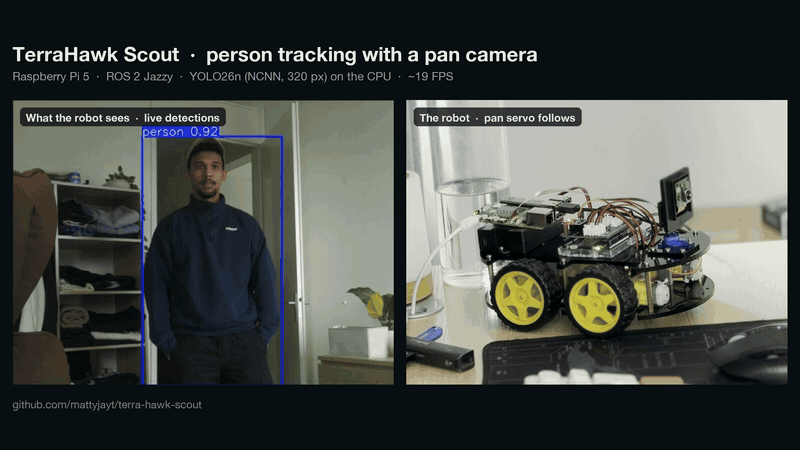
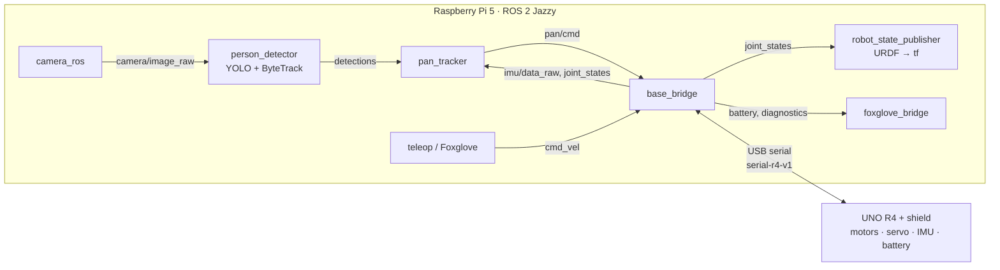

# TerraHawk Scout

[](https://github.com/mattyjayt/terra-hawk-scout/actions/workflows/ros-ci.yml)
[](LICENSE)

A small ROS 2 robot built from an Elegoo Smart Robot Car: a Raspberry Pi 5 runs the ROS 2 stack, an Arduino UNO R4 drives the motors, and a camera on a pan servo finds and follows people.

<!--
  MEDIA SLOT. To publish the demo:
  1. Add the GIF as docs/media/scout-tracking.gif
  2. Replace VIDEO_ID (twice) in the block below with the YouTube video ID
  3. Delete the "Demo video coming soon" line and uncomment the <p> block
-->
> 🎥 Demo video coming soon.

<!--
<p align="center">
  <a href="https://www.youtube.com/watch?v=VIDEO_ID">
    
  </a>
  <br>
  <a href="https://www.youtube.com/watch?v=VIDEO_ID">▶ Watch the full demo on YouTube</a>
</p>
-->

Scout is the mobile part of **TerraHawk**, a home-farm robotics project. The end goal: map the flat, drive to a pickup point, wait for cargo and deliver it to the grow tower.

## Status

| | What |
|---|---|
| ✅ **Works now** | Drive from `cmd_vel` (open loop, skid steer) with two safety layers: a 0.25 s command timeout in the bridge and a 300 ms watchdog on the R4 |
| | IMU at 20 Hz, battery voltage, pan servo; services `/base/stop`, `/imu/calibrate`, `/imu/zero_yaw` |
| | `/diagnostics`: link state, line rates, frozen-IMU detection (ERROR), battery not present (WARN) |
| | URDF + TF tree; one-command bringup with Foxglove and a saved Foxglove layout |
| | Camera in ROS 2 at 30 FPS (`camera_ros`, built from source with a Pi 5 patch) |
| | Person detection (YOLO + ByteTrack) and pan tracking: the camera follows a person. Gains are still being tuned |
| | CI on every PR: `colcon build` + `colcon test` in `ros:jazzy`, and an R4 firmware compile check |
| 🟡 **In progress** | C++ base bridge (`rclcpp`) that passes the same contract tests as the Python one |
| | RPLIDAR C1: arriving this week, not mounted yet |
| ⏳ **Planned** | Odometry without wheel encoders: LiDAR scan matching (`rf2o_laser_odometry`) fused with the gyro in a `robot_localization` EKF |
| | Map with `slam_toolbox`, then navigation with Nav2 |
| | Delivery mission: drive to pickup, wait for cargo, drive to the grow tower |
| | R4 firmware v2: modules and protocol v2 ([DD-SCOUT-FW](docs/design/DD-SCOUT-FW.md)) |

## Hardware

| Part | Role |
|---|---|
| Elegoo Smart Robot Car V4.0 chassis | plates, wheels, 4 TT motors **without encoders** (skid steer, left and right pairs) |
| Raspberry Pi 5, 8 GB | Ubuntu 24.04, ROS 2 Jazzy; runs every ROS node |
| Arduino UNO R4 WiFi + Elegoo shield (TB6612) | thin hardware layer over USB serial: motor PWM, pan servo, MPU-6050, battery, watchdog |
| MPU-6050 | IMU (accelerometer + gyro) on the shield's I²C bus |
| Pi Camera Module 3 (imx708) | on the pan servo |
| RPLIDAR C1 | 2D LiDAR, arriving this week |

The Scout has exactly two compute parts: the Pi 5 and the UNO R4 ([ADR-0006](docs/adr/0006-scout-pi-r4-only.md)). The R4 holds no robot logic. It speaks a plain text protocol, [serial-r4-v1](docs/specs/interfaces/serial-r4-v1.md). Parts list: [docs/hardware/bom.md](docs/hardware/bom.md).

## Architecture



- Every topic, type, unit, frame and QoS is fixed in the ROS 2 contract: [IF-ROS-TOPICS](docs/specs/interfaces/ros-topics.md).
- Interactive version of this graph: [docs/diagrams/scout-p1-graph/scout-p1-graph.html](docs/diagrams/scout-p1-graph/scout-p1-graph.html) (download and open in a browser).
- Base bridge design (threading, link state machine, safety layers, tests): [DD-SCOUT-BRIDGE](docs/design/DD-SCOUT-BRIDGE.md).

## Repository layout

```
terra-hawk-scout/
├── ros2_ws/src/
│   ├── scout_base_py/       base bridge node (Python): cmd_vel → R4, IMU, battery, pan, diagnostics
│   ├── scout_bringup/       base.launch.py, config, Foxglove layout, launch_testing contract suite
│   ├── scout_description/   URDF/xacro and description.launch.py
│   ├── scout_perception/    person_detector, pan_tracker, perception.launch.py
│   └── external/            third-party sources (camera_ros) from tools/scout.repos, not committed
├── firmware/
│   ├── r4_base/             UNO R4 firmware (serial-r4-v1)
│   └── r4_bench/            bench sketches: wheel test, IMU test, 90° turn
├── tools/                   fake_r4.py (R4 emulator), fake camera and detections, serial teleop,
│                            YOLO benchmark, udev rule, scout.repos, patches/
├── docs/                    PRD, requirements, interfaces, design docs, ADRs, test plan, diagrams
├── cad/                     build123d layout fit check (scout-layout) and a v2 design study (scout-v2)
└── .github/workflows/       ros-ci.yml (build, test, firmware), docs.yml (link check)
```

## Quick start

On the Pi 5 (Ubuntu 24.04, ROS 2 Jazzy). The R4 must run [`firmware/r4_base`](firmware/README.md) and show up as `/dev/scout_base` (udev rule in `tools/udev/`).

```bash
git clone https://github.com/mattyjayt/terra-hawk-scout.git
cd terra-hawk-scout

# Camera driver from source: pinned commit + Pi 5 patch
vcs import ros2_ws/src/external < tools/scout.repos
git -C ros2_ws/src/external/camera_ros apply "$PWD/tools/patches/camera_ros_controlinfomap.patch"

# Dependencies and build
cd ros2_ws
rosdep install --from-paths src --ignore-src -y
pip install ultralytics          # YOLO; not available through rosdep
colcon build --symlink-install
source install/setup.bash
```

Run:

```bash
# Camera (own terminal)
ros2 run camera_ros camera_node --ros-args -p camera:=0 -p width:=640 -p height:=480 \
  -p format:=RGB888 -p frame_id:=camera_optical_frame

# Base bridge + robot model + Foxglove + perception (person_detector, pan_tracker)
ros2 launch scout_bringup base.launch.py              # foxglove:=false to skip Foxglove

# Perception on its own
ros2 launch scout_perception perception.launch.py model_path:=<path to a YOLO model>
```

Connect Foxglove to `ws://<pi-hostname>:8765` and import the layout `ros2_ws/src/scout_bringup/foxglove/scout.json`.

## Testing

```bash
cd ros2_ws
colcon test
colcon test-result --verbose
```

About 35 tests: unit tests for the protocol parser, kinematics, conversions and the tracker maths; the ament linters; and a `launch_testing` contract suite that runs the real bridge against a fake R4 (command rate, stop on timeout, IMU shape, pan, services, link loss and recovery, frozen IMU).

The fake R4 emulates the board on a pseudo-terminal, so the bridge runs without hardware (software in the loop):

```bash
python3 tools/fake_r4.py                 # creates /tmp/fake_r4; --freeze-imu reproduces the frozen-IMU fault
ros2 launch scout_bringup base.launch.py port:=/tmp/fake_r4
```

CI runs the same build and tests on every pull request, plus a compile check of the R4 sketches.

## Documentation

The project is documentation-first ([ADR-0004](docs/adr/0004-documentation-first.md)): requirements, interface contracts and a design doc come before the code. Full index: [docs/README.md](docs/README.md).

| Kind | Documents |
|---|---|
| Product and requirements | [PRD](docs/product/prd.md) · [SRS](docs/specs/srs.md) · [Test plan](docs/testing/test-plan.md) |
| Interfaces | [ROS 2 contract (IF-ROS-TOPICS)](docs/specs/interfaces/ros-topics.md) · [Pi ↔ R4 serial protocol](docs/specs/interfaces/serial-r4-v1.md) |
| Design | [Base bridge](docs/design/DD-SCOUT-BRIDGE.md) · [Hardware](docs/design/DD-SCOUT-HW.md) · [R4 firmware](docs/design/DD-SCOUT-FW.md) · [Perception](docs/design/DD-SCOUT-PERC.md) |
| Decisions | [Architecture decision records](docs/adr/README.md) |
| Operations | [Runbook](docs/ops/runbook.md) · [Bill of materials](docs/hardware/bom.md) |

## License

[Apache-2.0](LICENSE)

## Author

Jaime Tellie · [jaime-tellie.com](https://www.jaime-tellie.com)
